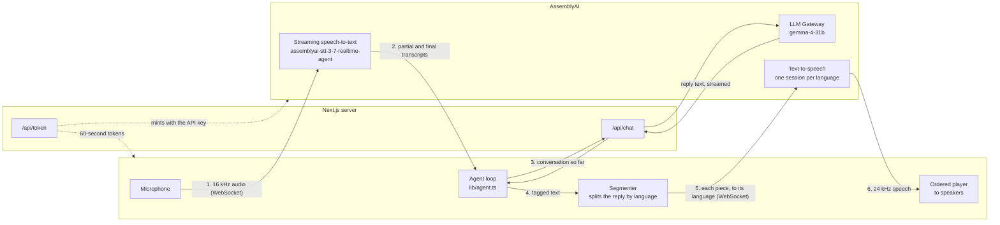

# Language tutor: a reference voice agent on AssemblyAI

A voice agent for language learners. You ask how to say something, the tutor teaches it in a native voice, you repeat it, and it tells you whether you got the words right. You can interrupt it at any point.

It runs on AssemblyAI with one API key: streaming speech-to-text, the LLM Gateway and streaming text-to-speech. It is built for a customer who runs this product on another provider and is deciding whether to switch, so the repo has two halves:

- **The agent** (`app/`, `lib/`, `components/`): a working reference implementation.
- **The evaluation harness** (`eval/`): compares AssemblyAI with the incumbent on what matters for this product. A Deepgram adapter is included.

## Run it

Requires Node 22 or later and pnpm.

```bash
pnpm install
cp .env.example .env      # then add your ASSEMBLYAI_API_KEY
pnpm dev                  # http://localhost:3000
```

Press **Start talking** and allow the microphone. Headphones help: they keep the tutor's voice out of the microphone.

Things to try:

- "How do I say *nice to meet you* in Spanish?" Then repeat the phrase back.
- Get it wrong on purpose and see whether the tutor catches it.
- Talk over the tutor mid-sentence. Then try just "mhm" while it talks.
- "Actually, how do you say that in French?" It switches language without a restart.

To run the evaluation:

```bash
pnpm eval:synth           # generate test audio with AssemblyAI TTS (once)
pnpm eval                 # stream it through each provider, write eval/results/latest.md
```

Add `DEEPGRAM_API_KEY` to `.env` to include Deepgram. The same key enables the app's **Speech-to-text** switch and **Compare both** mode, which send live microphone audio to Deepgram through a local relay (`lib/deepgram/relay.ts`, port 3001) so the key stays on the server. On a free AssemblyAI plan the evaluation takes about ten minutes, because new streaming sessions are limited to five per minute.

## How it's built



One turn follows the numbers. Audio never passes through the project's own server: the browser holds the speech connections, and the server only issues short-lived tokens and relays the text-only model call.

In step 4 the model's reply has every foreign phrase wrapped in a language tag, and step 5 uses the tags to pick a voice:


| File | What it does |
|---|---|
| `lib/agent.ts` | The conversation loop: turn-taking, barge-in, routing, metrics. Start here. |
| `lib/segmenter.ts` | Splits the LLM's stream into single-language segments. |
| `lib/aai/stt.ts`, `lib/aai/tts.ts` | Thin clients for the two AssemblyAI WebSockets. No SDK, so the protocol is visible. |
| `lib/audio/` | Microphone capture and ordered playback. |
| `lib/prompt.ts` | The tutor's instructions. |
| `app/api/` | Token minting and the LLM Gateway proxy. |
| `eval/` | Dataset, audio synthesis, provider adapters, runner and report. |

## Key decisions

### 1. One TTS session per language, routed by tags

A tutor's sentences are bilingual, but an AssemblyAI TTS session speaks one language, fixed at connect. The docs say what happens otherwise: "Text in another language than the session's comes out mispronounced." For a language-learning product, mispronouncing the phrase being taught is the one unacceptable failure.

So the LLM wraps foreign text in a language tag (`<es>buenos días</es>`), a streaming parser cuts the reply into single-language segments, and each segment goes to the TTS session for its language. Segments come back from different sockets, so the player buffers them and plays them strictly in order.

### 2. The browser connects straight to AssemblyAI

The server mints a 60-second token per connection, scoped to one product, and the browser opens the STT and TTS WebSockets itself. The API key never reaches the client, and audio skips an extra network hop. A customer with a telephony or native-app front end would run the same loop server-side; `lib/agent.ts` has no dependency on React.

### 3. Barge-in on transcript text, not on sound

Following AssemblyAI's guidance, the tutor does not stop on `SpeechStarted` alone. It stops when a partial transcript has two or more words that are not all filler, or when a complete non-filler turn arrives. "Mhm" and "okay" are shown and ignored; "yes" and "no" are never treated as filler.

On an interruption the LLM request is aborted, every TTS session gets a `Cancel`, and playback stops. The conversation history is then trimmed to what the learner actually heard, so the LLM does not assume they heard the rest.

### 4. Turn detection is tuned to this conversation, and changes mid-session

AssemblyAI does not end a turn on silence alone. After a short silence it checks whether the turn reads as finished; if not, or if it ends in something name-like that might continue, the turn is held until a maximum silence.

This product's most common sentence, "How do you say X in Spanish?", ends in a language name, so `max_turn_silence` decides how responsive the tutor feels. I tuned it in three steps:

1. **Default (1280 ms).** About 1.2 s from end of speech to transcript on questions.
2. **640 ms.** The clear winner on the synthetic test set: about 0.85 s, no split turns. In the first live session it cut a real speaker off at "Um, I would like to learn how to say…". Synthetic speech does not hesitate; people do.
3. **1000 ms for conversation, 1280 ms after a phrase is taught.** The agent sends `UpdateConfiguration` after each reply, giving a learner longer when the next turn is probably a hesitant attempt.

Both presets are in `lib/stt-config.ts`, which the harness imports, so the evaluation measures the configuration the agent runs. This trades tail latency for not interrupting learners, and the right values should come from the customer's real sessions.

### 5. Keyterm boosting is a switch, because it cuts both ways

After the tutor teaches a phrase, the agent can tell STT to expect it, as a keyterm, so the learner's attempt is recognised. The risk is that a recogniser told the correct answer will hear the correct answer: the learner says *je suis faim*, the transcript says *j'ai faim*, and the tutor praises a mistake.

The evidence is mixed:

- **On the test set, boosting helped.** Across six clips with a real learner error, it did not turn any mistake into the correct phrase, and it fixed two transcripts that were wrong without it.
- **In live use, it hid mistakes.** Deliberately mispronounced phrases came back transcribed correctly with boosting on.

So it is a switch in the UI (**Boost taught phrases**). Turning it off also removes the taught phrase from the conversation context sent to STT, so the recogniser is told nothing about the expected answer. Which default is right is the first thing I would settle with the customer's real audio.

One limit holds either way: *buenos tardes* came back as *buenas tardes* from both providers with no boosting at all. A one-vowel error is at the edge of what any speech-to-text model preserves.

### 6. Feedback stays within what a transcript can support

Speech-to-text reports which words were said, not how well. The prompt tells the tutor never to praise or criticise accent. One signal stretches this without overclaiming: words the recogniser was least confident about are passed to the LLM as a hint that the learner may have been unclear. Real pronunciation scoring needs a phoneme-level model and is out of scope.

### 7. LLM choice

`gemma-4-31b` through the LLM Gateway. Replies are one to three sentences, so time to first token matters more than throughput. My first pick from the gateway's published latency data, `gemini-2.5-flash-lite`, was not available to the account I built this on, which could call only two models. Of those, `gemma-4-31b` has the higher quality score, follows the tagging format reliably, and returned first text in 0.3 to 0.5 s. The model is one environment variable (`LLM_MODEL`), so a customer can A/B models without touching code.

## Latency

The sidebar reports four numbers per turn, all measured in the browser:

| Stage | Measured from → to |
|---|---|
| End of speech → transcript | End of the learner's last word → final transcript received. Includes the turn-detection wait. |
| Transcript → first LLM token | Final transcript received → first text from the LLM. |
| Text → first TTS audio | First segment sent to TTS → first audio frame received. |
| End of speech → tutor audible | The learner's last word → the first audio starts playing. |

The last one is the number the learner feels. I measure from end of speech because AssemblyAI's own evaluation guide argues that time-to-first-token is easy to game and says little about a voice agent.

## Winning the customer's evaluation

The customer already has a working product, so "AssemblyAI is accurate" is not an argument. The evaluation has to answer one question: **is their tutor better for learners on AssemblyAI than on what they run now, measured on their own traffic?** My approach is to agree what "better" means first, measure it on their audio, and be upfront about where AssemblyAI is not the answer.

### What to measure

Generic word error rate on clean English is the wrong test. Learner speech has four distinct shapes, and the harness scores each separately (`eval/dataset.ts`):

| Kind | Example | What it tests |
|---|---|---|
| `ask` | "How do you say good morning in Spanish?" | Baseline accuracy in the learner's language. |
| `attempt` | "Buenos días." | Short target-language speech with no context. |
| `mixed` | "Is it *bonjour* or *bonsoir* in the evening?" | Code-switching inside one sentence. |
| `near_miss` | "Buenos tardes." (taught: *buenas tardes*) | Whether the transcript keeps a learner's mistake. |

And four measurements:

1. **Accuracy by kind.** WER per kind, plus how often a foreign phrase inside an English sentence comes through intact.
2. **Error preservation.** On near-miss utterances, did the transcript say what the learner said? A model that corrects toward the expected answer makes a tutor useless. Every provider runs with and without keyterm boosting.
3. **Turn detection.** Each utterance is one turn. Two finals means the learner was cut off; none means the provider never noticed they finished.
4. **Latency to a complete transcript.** From end of speech to the final transcript, including the endpointing wait. Time to first partial is not reported, because the agent does not act on it.

### How I'd run it with the customer

1. **Get their audio.** A few hundred real learner utterances across their top language pairs, with consent, dropped into `eval/audio/`. The synthetic set here exists only so the harness runs before that.
2. **Audit the ground truth by listening.** Human transcripts of learner and code-switched speech are often wrong, and a bad reference makes the better model look worse.
3. **Match the incumbent's real configuration.** The model and endpointing value are environment variables. Any other vendor is one function to implement (`Provider` in `eval/providers.ts`).
4. **Agree pass criteria first.** For example: no worse on `ask`, better on `attempt` and `mixed`, no silently corrected near-misses, and latency within their budget.
5. **Then test live, side by side.** Offline numbers don't capture a real microphone or how barge-in feels. The app's **Compare both** mode sends the same live audio to both providers.
6. **Plan the migration.** STT is the low-risk first step: a WebSocket swap, with turn detection re-tuned from a silence timer to content-aware endpointing. TTS and the LLM Gateway can follow independently.

### Where I would not oversell

- If the customer teaches languages outside the six TTS supports, AssemblyAI is the STT and LLM layer and they keep their current TTS for those languages.
- If their differentiator is pronunciation scoring, no general speech-to-text model provides that, and I would say so in the first meeting.

### Results from the harness

Four full runs gave the same picture: accuracy was identical each time and latency moved by tens of milliseconds. The complete report is in [`eval/results/latest.md`](eval/results/latest.md), and the app charts it at `/compare`.

**Read this before the numbers.** The audio is synthetic, there are 26 utterances, and the speech was generated by AssemblyAI's own TTS, which may favour AssemblyAI's STT. Deepgram ran in its documented multilingual configuration (`nova-3`, `language=multi`, 300 ms endpointing), not one tuned for production. This shows the harness works and where to look. It is not a benchmark.

| | AssemblyAI | Deepgram |
|---|---|---|
| WER, English questions | 0.0% | 0.0% |
| WER, target-language attempts | 3.1% | 50.0% |
| WER, mixed-language sentences | 0.0% | 8.1% |
| Foreign phrases intact in mixed sentences | 100% | 71% |
| Exactly one turn per utterance | 100% | 100% |
| End of speech → transcript, median | 514 ms | 460 ms |
| End of speech → transcript, 90th percentile | 1301 ms | 534 ms |

Did the transcript keep the learner's mistake?

| | Kept the mistake | Wrote the correct phrase instead | Wrote something else |
|---|---|---|---|
| AssemblyAI | 4 of 6 | 1 | 1 |
| AssemblyAI + keyterms | 5 of 6 | 1 | 0 |
| Deepgram | 1 of 6 | 1 | 4 |
| Deepgram + keyterms | 1 of 6 | 1 | 4 |

What I take from it:

- **Short target-language attempts are where the providers separated.** Deepgram often heard them as English ("Guggen Morgan?" for *Guten Morgen*). Boosting the taught phrase cut its WER on correct attempts from 50% to between 6% and 13% across runs. AssemblyAI was at 3.1% without boosting and 0% with.
- **AssemblyAI is slower at the tail.** Its median is close to Deepgram's, but questions ending in a language name are held open (decision 4) and took about 1.3 s, against about 0.46 s on Deepgram's fixed 300 ms timer. A fixed timer is faster on fluent speech and cannot wait for a hesitating learner, which this synthetic set does not test.
- **Neither provider preserved the one-vowel error** (*buenos tardes*).

## Limits

- **Six spoken languages.** STT covers 32, but TTS speaks English, Spanish, French, German, Italian and Portuguese.
- **No pronunciation scoring.** See decision 6.
- **No speed control.** TTS has no rate parameter, so "say it slowly" can only be approximated with punctuation.
- **Synthetic evaluation audio.** Numbers from it show the harness works; they are not a benchmark.
