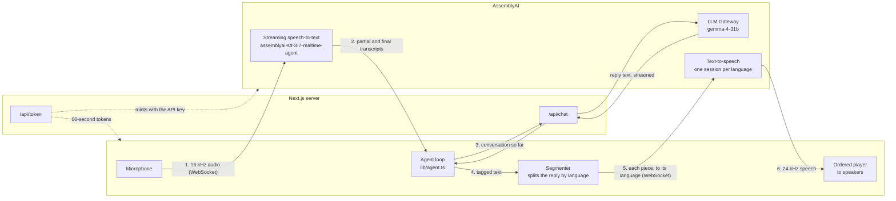
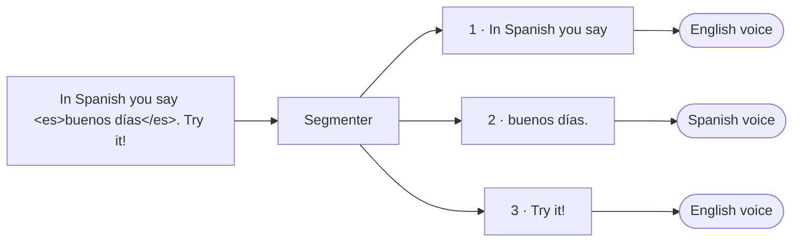

# Language tutor: a reference voice agent on AssemblyAI

A voice agent for language learners. You ask how to say something, the tutor teaches it in a native voice, you repeat it, and it tells you whether you got the words right. You can interrupt it at any point.

It runs entirely on AssemblyAI: streaming speech-to-text, the LLM Gateway and streaming text-to-speech, with one API key. It is built for a customer who runs this product on another provider today and is deciding whether to switch, so the repo has two halves:

- **The agent** (`app/`, `lib/`, `components/`): a working reference implementation.
- **The evaluation harness** (`eval/`): a way to compare AssemblyAI against the incumbent on the things that matter for this product, with a Deepgram adapter included.

## Run it

Requires Node 22 or later and pnpm.

```bash
pnpm install
cp .env.example .env      # then add your ASSEMBLYAI_API_KEY
pnpm dev                  # http://localhost:3000
```

Press **Start talking** and allow the microphone. Use headphones if you can: barge-in relies on the browser's echo cancellation to keep the tutor's voice out of the microphone, and headphones remove the problem entirely.

Things to try:

- "How do I say *nice to meet you* in Spanish?" Then repeat the phrase back.
- Get it wrong on purpose (say *buenos tardes* for *buenas tardes*) and see whether the tutor catches it.
- Talk over the tutor mid-sentence. Then try just "mhm" while it talks.
- "Actually, how do you say that in French?" The tutor switches language without a restart.

To run the evaluation:

```bash
pnpm eval:synth           # generate test audio with AssemblyAI TTS (once)
pnpm eval                 # stream it through each provider, write eval/results/latest.md
```

Add `DEEPGRAM_API_KEY` to `.env` to include Deepgram in the comparison. The same key also enables the app's **Speech-to-text** switch and **Compare both** mode, which send your live microphone audio to Deepgram through a small local relay (`lib/deepgram/relay.ts`, port 3001) so the key stays on the server. On a free AssemblyAI plan the run takes about ten minutes, because new streaming sessions are limited to five per minute and the harness waits its turn; on a paid plan it takes about two.

## How it's built



One turn follows the numbers. Audio never passes through the project's own server: the browser holds the speech connections itself, and the server only issues short-lived tokens and relays the text-only model call.

In step 4 the model's reply has every foreign phrase wrapped in a language tag, and step 5 uses the tags to pick a voice:



| File | What it does |
|---|---|
| `lib/agent.ts` | The conversation loop: turn-taking, barge-in, routing, metrics. Start here. |
| `lib/segmenter.ts` | Splits the LLM's stream into single-language segments. |
| `lib/aai/stt.ts`, `lib/aai/tts.ts` | Thin clients for the two AssemblyAI WebSockets. No SDK, so the protocol is visible. |
| `lib/audio/` | Microphone capture and ordered playback. |
| `lib/prompt.ts` | The tutor's instructions. |
| `app/api/` | Token minting and the LLM Gateway proxy. |
| `eval/` | Dataset, audio synthesis, provider adapters, runner and report. |

## Key decisions

### 1. One TTS session per language, routed by tags

A tutor's sentences are bilingual: "In Spanish you say *buenos días*." An AssemblyAI TTS session speaks one language, fixed at connect, and the docs are direct about the alternative: "Text in another language than the session's comes out mispronounced." For a language-learning product, mispronouncing the phrase being taught is the one unacceptable failure.

So the LLM is prompted to wrap foreign text in a language tag (`<es>buenos días</es>`), a streaming parser cuts the reply into single-language segments, and each segment goes to the TTS session for its language. The target phrase is spoken by a voice recorded in that language. Sessions for the learner's language and the language being learned are opened at the start; others open the first time they are needed.

Because segments come back from different sockets, the player buffers each one and plays them strictly in order (`lib/audio/player.ts`).

### 2. The browser connects straight to AssemblyAI

The Next.js server mints a 60-second token per connection, scoped to a single product, and the browser opens the STT and TTS WebSockets itself. The API key never reaches the client. The alternative, relaying audio through my own server, adds a network hop to every audio frame in both directions and needs a WebSocket server that Next.js route handlers don't provide. A customer with a telephony or native-app front end would run the same loop server-side; `lib/agent.ts` has no dependency on React.

### 3. Barge-in on transcript text, not on sound

Following AssemblyAI's guidance, the tutor does not stop on `SpeechStarted` alone. It stops when a partial transcript has two or more words that are not all filler, or when a complete turn arrives that is not filler. "Mhm" and "okay" are shown in the transcript and ignored. "Yes" and "no" are never treated as filler, in any of the six languages.

On an interruption three things happen: the LLM request is aborted, every TTS session gets a `Cancel`, and playback stops. Audio that arrives between `Cancel` and the server's `Cancelled` is discarded, as the protocol requires. The conversation history is then rewritten to contain only what the learner actually heard, so the LLM does not assume they heard the rest.

### 4. Turn detection is tuned to this conversation, and changes mid-session

AssemblyAI does not end a turn on silence alone. After a short silence it checks whether the turn reads as finished; if it doesn't, or if it ends in something name-like that might continue, the turn is held until a maximum silence.

That matters here because this product's most common sentence, "How do you say X in Spanish?", ends in a language name, and attempts often end in the learner's own name ("Me llamo Connor"). Both get held for the full maximum, so `max_turn_silence` sets how responsive the tutor feels. I tuned it in three steps, and the second one is the instructive one:

1. **Default (1280 ms).** The harness measured about 1.2 s from end of speech to transcript on questions.
2. **640 ms.** On the synthetic test set this was the clear winner: about 0.85 s, no split turns. In the first live session it cut a real speaker off at "Um, I would like to learn how to say…" and the tutor answered half a question. Synthetic speech does not hesitate; people do.
3. **1000 ms for conversation, 1280 ms after a phrase is taught.** The agent sends `UpdateConfiguration` after each reply, giving a learner slightly longer when the next turn is probably a hesitant attempt. An earlier 1600 ms for attempts made every reply after a taught phrase feel slow.

The sidebar shows the live values. Both presets are in `lib/stt-config.ts`, which the harness imports, so the evaluation measures the configuration the agent runs. The honest summary is that this trades tail latency for not interrupting learners, and the right values should come from the customer's real sessions.

### 5. Keyterm boosting: I expected it to hurt, measured it, and turned it on

After the tutor teaches a phrase, the agent can send that phrase to STT as a keyterm so the learner's attempt is recognised. My worry was that this biases the recogniser toward the *correct* answer: if the learner says *je suis faim* and the transcript says *j'ai faim*, the tutor praises a mistake. For this product, a transcript faithful to an error matters more than one that is confidently right, so I first built this as a toggle defaulting to off.

Then I measured it. The harness has six "near-miss" utterances, each a real learner error, run with and without the taught phrase boosted (results below). Boosting did not turn any mistake into the correct phrase, and it fixed two transcripts that were wrong without it. So it now defaults to on, and stays a toggle.

One near-miss was lost either way: *buenos tardes* came back as *buenas tardes*, with and without keyterms, from both providers. A one-vowel agreement error is at the edge of what any speech-to-text model will preserve, and the tutor should not be sold as catching those. Six synthetic utterances is also not much evidence; this is the first test I would repeat on the customer's real audio.

Separately, after every reply the agent sends `agent_context` (the tutor's last utterance), which gives the model conversational context for short answers.

### 6. Feedback stays within what a transcript can support

Speech-to-text reports which words were said, not how well. The prompt tells the tutor never to praise or criticise accent. Two signals stretch this a little without overclaiming: the detected language of each turn, and the words the recogniser was least confident about, which are passed to the LLM as a hint that the learner may have been unclear on that word. Real pronunciation scoring needs a phoneme-level model and is out of scope.

### 7. LLM choice

`gemma-4-31b` through the LLM Gateway. Replies are one to three sentences, so time to first token matters far more than throughput, and the gateway publishes latency and quality data per model (`GET /v1/models`) to choose from. My first pick from that data, `gemini-2.5-flash-lite`, was not available to the account I built this on, which could call only two models on the gateway. Of those, `gemma-4-31b` has the higher quality score, follows the language-tagging format reliably, and returned first text in 0.3 to 0.5 s in my tests. The model is one environment variable (`LLM_MODEL`), which is the point of using the gateway: the customer can A/B models without touching code.

## Latency

The sidebar reports four numbers per turn, all measured in the browser:

| Stage | Measured from → to |
|---|---|
| End of speech → transcript | The end timestamp of the learner's last word → final transcript received. Both are on the audio clock, so this includes the turn-detection wait and is not flattered by when speech "started". |
| Transcript → first LLM token | Final transcript received → first text from the LLM. |
| Text → first TTS audio | First segment sent to TTS → first audio frame received. |
| End of speech → tutor audible | The learner's last word → the moment the first audio is scheduled to play. |

The last one is the number the learner feels. I measure from end of speech because AssemblyAI's own evaluation guide makes the case that time-to-first-token is easy to game and tells you little about a voice agent.

## Winning the customer's evaluation

The customer already has a working product, so "AssemblyAI is accurate" is not an argument. The evaluation has to answer one question: **is their tutor better for learners on AssemblyAI than on what they run now, measured on their own traffic?** My approach is to agree what "better" means before running anything, measure it on their audio, and be upfront about where AssemblyAI is not the answer.

### What to measure, and why these things

Generic word error rate on clean English is the wrong test for this product. Learner speech has four distinct shapes, and the harness scores each separately (`eval/dataset.ts`):

| Kind | Example | What it tests |
|---|---|---|
| `ask` | "How do you say good morning in Spanish?" | Baseline accuracy in the learner's language. |
| `attempt` | "Buenos días." | Short, accented, target-language speech with no surrounding context. |
| `mixed` | "Is it *bonjour* or *bonsoir* in the evening?" | Code-switching inside one sentence. The foreign words are the ones that matter. |
| `near_miss` | "Buenos tardes." (taught: *buenas tardes*) | Whether the transcript keeps a learner's mistake or quietly fixes it. |

And four measurements:

1. **Accuracy by kind.** WER per kind, plus how often a foreign phrase inside an English sentence comes through intact.
2. **Error preservation.** On near-miss utterances, did the transcript say what the learner said? This is specific to language learning and I'd expect it to be new to the customer: a model that "helpfully" corrects toward the expected answer makes a tutor useless. The harness runs every provider with and without keyterm boosting, because boosting the expected phrase is the obvious thing to do and the obvious way to cause this.
3. **Turn detection.** Each test utterance is one turn. A provider that returns two has cut the learner off mid-phrase; one that returns none never noticed they finished. Learners pause a lot, so this is where voice agents for this audience usually feel broken.
4. **Latency to a complete transcript.** From end of speech to the final transcript, including the endpointing wait. That is the delay before the agent can start thinking. Time to first partial is not reported, because the agent does not act on it.

### How I'd run it with the customer

1. **Get their audio.** A few hundred real learner utterances from production, across their top language pairs and proficiency levels, with consent. Drop them into `eval/audio/` and list them in `eval/dataset.ts`. The synthetic set in this repo exists only so the harness runs before that happens.
2. **Audit the ground truth by listening.** Human transcripts of code-switched and learner speech are often wrong, and near-miss labels need someone who speaks the language. A bad reference makes the better model look worse.
3. **Match the incumbent's real configuration.** The Deepgram adapter uses Deepgram's recommended multilingual setup, but the fair comparison is against whatever the customer runs today: their model, their endpointing value. Those are environment variables. Any other vendor is one function to implement (`Provider` in `eval/providers.ts`).
4. **Agree pass criteria first.** For example: no worse on `ask`, better on `attempt` and `mixed`, zero silently corrected near-misses, fewer split turns, and end-of-speech-to-transcript latency within their budget. Writing these down before the run keeps the result from being argued after.
5. **Then test live, side by side.** Offline numbers don't capture a real microphone, a real room, or how barge-in feels. Point this reference agent at a small share of real sessions, or put both stacks in front of their team for an afternoon, and compare the latency panel and the session recordings.
6. **Plan the migration.** STT is the low-risk first step: it is a WebSocket swap (AssemblyAI publishes a Deepgram migration guide), and turn detection moves from a silence timer to punctuation-aware endpointing, which needs re-tuning rather than porting. TTS and the LLM Gateway can follow independently, or not at all.

### Where I would not oversell

- If the customer teaches languages outside the six TTS supports, AssemblyAI is the STT and LLM layer and they keep their current TTS for those languages. The architecture here supports that: a TTS session is one small class.
- If their differentiator is pronunciation scoring, no general speech-to-text model provides that, and I would say so in the first meeting.

### Results from the harness

Four full runs gave the same picture: accuracy was identical each time, and latency moved by tens of milliseconds. The figures below are from the last run. The complete report, with every transcript, is in [`eval/results/latest.md`](eval/results/latest.md).

**Read this before the numbers.** The audio is synthetic, there are 26 utterances, and the speech was generated by AssemblyAI's own TTS, which may favour AssemblyAI's STT. Deepgram ran in its documented multilingual configuration (`nova-3`, `language=multi`, 300 ms endpointing, with language hints), not a configuration tuned by someone who runs it in production. This shows the harness works and where to look. It is not a benchmark, and I would not show it to the customer as one.

| | AssemblyAI | Deepgram |
|---|---|---|
| WER, English questions | 0.0% | 0.0% |
| WER, target-language attempts | 3.1% | 50.0% |
| WER, mixed-language sentences | 0.0% | 8.1% |
| Foreign phrases intact in mixed sentences | 100% | 71% |
| Exactly one turn per utterance | 100% | 100% |
| End of speech → transcript, median | 514 ms | 460 ms |
| End of speech → transcript, 90th percentile | 1301 ms | 534 ms |

Near-miss utterances (did the transcript keep the learner's mistake?):

| | Kept the mistake | Wrote the correct phrase instead | Wrote something else |
|---|---|---|---|
| AssemblyAI | 4 of 6 | 1 | 1 |
| AssemblyAI + keyterms | 5 of 6 | 1 | 0 |
| Deepgram | 1 of 6 | 1 | 4 |
| Deepgram + keyterms | 1 of 6 | 1 | 4 |

What I take from it:

- **Short target-language attempts are where the providers separated.** Deepgram often heard them as English ("Guggen Morgan?" for *Guten Morgen*, "Whoa, Stir Bonhoef?" for *Wo ist der Bahnhof?*). With the taught phrase boosted, its WER on correct attempts fell from 50% to between 6% and 13% across runs, so on Deepgram keyterms are close to mandatory for this use case. AssemblyAI was at 3.1% without them and 0% with.
- **AssemblyAI is slower at the tail, and I'd say so.** Its median is close to Deepgram's, but questions ending in a language name are held open by entity-aware endpointing (decision 4) and took about 1.3 s, against about 0.46 s on Deepgram's fixed 300 ms silence timer. A fixed timer is faster on fluent speech and has no way to wait for a hesitating learner, which this synthetic set, with no hesitations in it, does not test. Real learner audio with pauses is what would settle whether that trade is worth it.
- **Neither provider preserved the one-vowel error** (*buenos tardes*). See decision 5.


## Limits

- **Six spoken languages.** STT covers 32, but TTS speaks English, Spanish, French, German, Italian and Portuguese, so those are what the tutor can teach aloud.
- **No pronunciation scoring.** See decision 6.
- **No speed control.** TTS has no rate parameter, so "say it slowly" can only be approximated with punctuation.
- **Synthetic evaluation audio.** The harness ships with TTS-generated utterances so it runs out of the box. Numbers from it show the harness works; they are not a benchmark.
